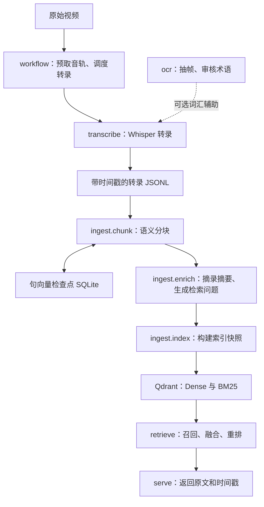
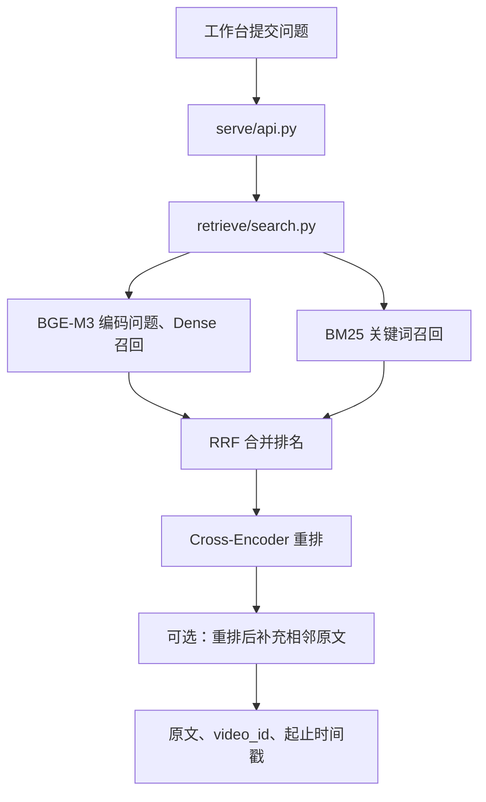

# Video RAG 软件架构与代码导读

本文依据 `experiment/post-rerank-context` 分支的实现整理，基准代码提交为
`d65752476ba29b7545e6eec4ae4d2ca0a5fa1732`。记录日期：2026-10-26。
源码后续变化时，以对应模块为准；本文也区分了已有功能、可选功能和恢复能力的边界。

## 1. 项目做什么

将本地培训视频转换成带来源、时间戳和原文的可检索证据，向现有聊天工作台提供
检索 API。可以按三个部分理解：

| 部分 | 工作内容 | 主要目录 |
|---|---|---|
| 离线加工 | 视频转录、语义分块、原文增强、构建索引 | `workflow/`、`transcribe/`、`ocr/`、`ingest/` |
| 在线检索 | 接收问题、召回候选、融合、重排、返回证据 | `retrieve/`、`serve/` |
| 公共基础与验证 | 配置、数据结构、模型、存储、测试和评估 | `core/`、`tests/`、`eval/`、`test/` |

视频、转录、索引和实际评测数据保留在本地。最终证据来自转录原文，不把模型生成的问题
当作事实来源。当前 API 只做检索，最终自然语言回答由接入的聊天工作台生成。

## 2. 总体数据流

注意以下实现细节：

- 当前主检索链使用 **Qdrant**；`workflow/video_kb/` 中保留的是旧 Chroma 实现。
- OCR 辅助转录已经有独立工具，但当前 `workflow/pipelined_asr.py` 调用
  `transcribe.run` 时明确传入 `--no-vocab`，因此 V7 不会自动启用 OCR 词汇辅助。
- 原文 Dense 与 BM25 是两条检索通道；这里没有把 BGE-M3 的学习式稀疏输出当成 BM25。

## 3. 各文件夹的职责

| 文件夹 | 职责 | 主要输入 | 主要输出 |
|---|---|---|---|
| `workflow/` | V7 调度、音轨预取、转录复用；同时保留旧工作流 | 视频清单、原始视频、已有转录 | 本地 WAV、正式转录、登记表、日志 |
| `transcribe/` | 本地 Whisper 转录与窗口恢复 | 视频或准备好的音轨、可选确认词汇 | 带时间戳的 JSONL、窗口检查点、审计文件 |
| `ocr/` | 抽帧 OCR、候选术语提取、导入人工审核结果 | 视频、OCR 记录、审核 CSV | 截图、OCR 记录、确认词汇库 |
| `ingest/` | 语义分块、增强、索引构建 | 转录 JSONL | 块、句向量缓存、增强结果、索引快照 |
| `retrieve/` | Dense/BM25 召回、RRF、重排、上下文扩展 | 问题、索引、检索配置 | 排序后的原文证据 |
| `serve/` | FastAPI 服务、请求校验、鉴权、结果整理 | HTTP 查询请求 | `/health`、`/search` 响应 |
| `core/` | 共用的配置、结构校验、模型、文件、媒体、词汇和存储组件 | 配置与业务数据 | 供其他模块调用的基础能力 |
| `eval/` | gold 集制作与冻结、检索指标、ASR 指标 | 评测问题、标准证据、检索/转录结果 | 指标、置信区间、逐题诊断 |
| `tests/` | 自动化测试、失败路径和恢复验证 | 测试样例、测试替身 | 通过或失败的测试结果 |
| `test/` | 公开来源实验、真实模型冒烟测试、对照配置和实验报告 | 公开媒体来源、实验配置 | 实验结果与诊断报告 |
| `tools/` | 模型准备等交付辅助操作 | 模型 ID 或本地模型路径 | 模型缓存与下载清单 |
| `examples/` | 虚构样例和格式示范 | 示例内容 | 可用于跑通流程的转录、gold 和词汇文件 |
| `docs/` | 设计、操作、评估、状态和调试文档 | 已确认的实现与实验记录 | 项目说明 |

`tests/` 主要回答“程序行为是否正确”，`test/` 主要用于回答“真实模型和方案效果如何”。
测试替身通过不能替代实际模型效果验证。

## 4. V7 调度与转录

### 4.1 入口脚本与生成工具

你在公司电脑运行的入口是 `run_video_rag_prefetch_v7.sh`。它负责路径配置、扫描、
调用转录调度，以及后续合并、分块、增强和建库步骤。

该完整入口是本地生成/分发的脚本，不是本基准提交中直接跟踪的根目录文件。
仓库提供以下生成工具：

| 文件 | 作用 |
|---|---|
| [workflow/make_v6.py](../workflow/make_v6.py) | 从完整 V5 脚本生成带转录登记表的 V6 |
| [workflow/make_v7.py](../workflow/make_v7.py) | 从完整 V6 脚本生成单后台预取的 V7 |
| [workflow/prepare_v7.sh](../workflow/prepare_v7.sh) | 调用 V7 生成器，并执行 `bash -n` 语法检查 |

这些生成工具不是日常数据处理步骤；已有正确的 V7 入口后，不需要每次重新生成。
本地入口可能有手动路径修改，不能直接认定它与某次生成结果完全相同。

### 4.2 转录关键文件

| 文件 | 工作内容 |
|---|---|
| [workflow/pipelined_asr.py](../workflow/pipelined_asr.py) | 按名称规划任务，复用已准备音轨，调度前台 Whisper 与一个后台音轨预取任务 |
| [workflow/transcript_registry.py](../workflow/transcript_registry.py) | 校验完整转录及审计哈希、登记可复用转录、为同名来源生成带对应 `video_id` 的副本 |
| [transcribe/run.py](../transcribe/run.py) | 加载本地 Whisper、按窗口转录、保存并校验窗口检查点、发布最终 JSONL 与审计 |

当前视频转录期间，后台最多预取下一个视频。预取通过 FFmpeg 顺序提取完整本地 WAV，
Whisper 再读取本地音轨，减少对 OneDrive 原视频的反复读取。

按文件名复用是本项目采用的显式规则，并不证明同名文件的二进制内容必然相同。
完整复用需要审计校验，不能只看 JSONL 是否存在。

当前调度为各视频启动独立的 `transcribe.run` 子进程，所以 Whisper 模型会在相应进程中
重新加载；一个视频的多个窗口在该进程内复用模型。

## 5. 分块、增强和建库

| 文件 | 工作内容 | 下一阶段需要什么 |
|---|---|---|
| [ingest/chunk.py](../ingest/chunk.py) | 转录拆句，计算句子相似度，结合时间、间隙与 token 限制组成块 | 原文、块 ID、时间范围、来源片段 |
| [ingest/embedding_cache.py](../ingest/embedding_cache.py) | 按模型身份和精确句子内容保存向量，逐批事务提交 | 重启后可复用的句向量 |
| [ingest/enrich.py](../ingest/enrich.py) | 调用本地 Ollama，生成逐字摘录摘要、检索问题及原文证据，并校验 | 带增强状态的块 |
| [ingest/index.py](../ingest/index.py) | 编码块原文、计算 BM25、写入独立 Qdrant 快照，成功后发布 | 可检索的索引快照 |
| [ingest/convert_legacy.py](../ingest/convert_legacy.py) | 将旧时间戳 Markdown 转为标准转录；推定结束时间标为 `estimated` | 标准 JSONL 转录 |

增强入口会先复用已有 Ollama；本机连接被拒绝时，自动以禁用云功能的环境后台启动已有
Ollama，服务与模型检查通过后才处理原文。不自动安装或下载模型。
实现位于 `core/ollama.py`，详情见 [Ollama 自动启动](OLLAMA_STARTUP.md)。

### 5.1 为什么有两次 embedding

| 阶段 | 编码对象 | 用途 |
|---|---|---|
| 语义分块 | 单句 | 判断句子应如何组合 |
| 建索引 | 完整块原文 | 让问题能够检索到这个块 |
| 在线查询 | 用户问题 | 与索引中的块向量匹配 |

完整块的编码依赖上下文，不能直接把句向量平均后视作等价结果。分块和建索引使用同一类
模型，但服务于不同目的。分块进程加载一次模型处理全部输入，不是每个视频加载一次。
随后独立启动建库进程时，需要在新进程中重新加载模型，但不需要重新下载权重。

### 5.2 增强内容如何参与检索

- Dense：只编码块原文。
- BM25：使用块原文和生成的问题。
- 摘要：采用原文一句摘录，不参与向量编码。
- 重排：比较问题与候选原文。
- 最终证据：仍然是转录原文和对应视频时间范围。

增强校验包含 JSON 结构、摘要摘录、证据字面存在、重复问题和数字检查；这些检查不等于
已经证明问题在语义上完全成立，仍需要抽查。

### 5.3 当前哪些步骤可以续跑

| 阶段 | 已保存的中间结果 | 重启行为 |
|---|---|---|
| 音轨准备 | 完整 WAV 与准备元数据 | 满足准备校验时复用，不重新提取 |
| Whisper 转录 | 每个时间窗口的检查点 | 校验后跳过已完成窗口 |
| 完整转录 | JSONL、审计文件、转录登记表 | 有效结果直接复用 |
| 分块中的句子编码 | `chunk_embeddings.sqlite3` | 校验模型身份、向量形状和哈希后复用已编码句子 |
| 分块组装 | 全部成功后发布块 JSONL | 中断后重新组装，但句向量可以复用 |
| Ollama 增强 | 当前全部完成后才写正式输出 | 尚无逐块持久化恢复，不能认为已打印处理数量就已保存 |
| 索引构建 | 独立 generation 快照；成功后切换 `CURRENT` | 当前为完整快照重建，失败不会发布，也不会自动续建失败快照 |

句向量缓存每个推理批次提交一次，当前默认批量为 8。已提交批次可以恢复；中断时尚未
保存的最后一批可能重算。重复句子可跨视频复用，但最终来源和时间戳保持分离。
模型身份或相关设置变化时使用独立缓存空间；本地模型内容变化也会使旧缓存失效。
改变批次组合可能引入微小浮点差异，语义切分规则本身不变。

旧版没有落盘的向量不能从旧进程追补。完整恢复规则见
[embedding_checkpoints.md](embedding_checkpoints.md)。

### 5.4 chunk 如何决定大小，是否存在重叠

当前不是固定长度滑动窗口。每个视频独立拆句，按起止时间排序，对句子编码后逐句组装。
与当前块最近最多三句向量的均值比较，判断下一句是否发生话题变化。

默认配置如下，实际值以生效配置为准：

| 配置 | 默认值 | 作用 |
|---|---|---|
| `chunking.min_seconds` | 15 秒 | 当前块至少达到这个跨度，才允许因语义变化切分；不是所有块的最小长度保证 |
| `chunking.max_seconds` | 90 秒 | 加入下一句后，块的时间跨度不能超过此值 |
| `chunking.gap_seconds` | 10 秒 | 下一句与当前块之间间隔大于此值时切分 |
| `chunking.similarity_threshold` | 0.65 | 当前块达到最短跨度后，下一句相似度低于此值时切分 |
| `models.max_tokens` | 1024 | 块原文的模型 token 上限，不是字符数；分隔换行也计入 |

对于每个候选下一句，若满足以下任一条件，就先结束当前块，再把这句加入新块：

1. 加入后时间跨度大于 90 秒。
2. 下一句起点与当前块最晚终点的间隙大于 10 秒。
3. 加入后完整块原文超过 1024 token。
4. 当前块跨度已达到 15 秒，且下一句与最近最多三句均值向量的余弦相似度小于 0.65。

视频结束时输出剩余内容，所以尾块、遇到长间隙或 token 上限的块可能短于 15 秒。
单条输入的时间跨度已经大于 90 秒，或拆出的单句已经超过 token 上限时，程序直接报错，
不会截断原文、伪造句子时间或强行挤进块。

例子：当前块覆盖 0–20 秒，下一句覆盖 20–28 秒，相似度 0.50，则在该句之前切分。
如果相似度 0.80、间隙与 token 数均合规，就继续合并；没有额外目标要求必须凑到 90 秒。

当前没有 `chunk_overlap`，下一块也不会自动复制上一块的最后若干句。ASR 同一 segment
拆出的句子继承该 segment 的完整时间范围，因此相邻块的时间标签可能重叠，这不等于
设计了固定比例的内容重叠。

保留问答上下文采用另一种机制：检索命中块之后，由 `retrieve/context.py` 根据
`retrieval.context_seconds` 向前后补充同视频原句。默认值为 0，即关闭；配置允许 0–60 秒，
扩展还受最大块跨度、间隙和 token 上限约束，不保证补满指定秒数。设置
`expand_after_rerank=true` 才是先重排小块再补上下文。

如果需要人工试验，可先将 `context_seconds` 设为 10，并开启 `expand_after_rerank`，
再用独立评测比较召回和证据完整性。这只是待验证的起点，不是已经证明最优的重叠大小。
这两个检索配置变化可以在重启检索进程后比较，不要求为此重建原始分块。

## 6. 在线检索与 API

| 文件 | 作用 |
|---|---|
| [retrieve/search.py](../retrieve/search.py) | 加载 `CURRENT` 指定快照、校验配置、两路召回、RRF、调用重排 |
| [retrieve/rerank.py](../retrieve/rerank.py) | 加载 Cross-Encoder 并对候选原文排序 |
| [retrieve/context.py](../retrieve/context.py) | 在时间、间隙和 token 预算内补充相邻原句 |
| [serve/api.py](../serve/api.py) | API key 鉴权、请求校验、`/health` 与 `/search`、返回上下文 |

默认检索参数是每路最多召回 30 条，RRF 后保留最多 30 条，重排输出默认前 5 条。
数值由配置控制，分数不是概率。

上图展示开启 `expand_after_rerank` 时的扩展位置。实际顺序由配置决定：
`context_seconds=0` 时不扩展；开启上下文且 `expand_after_rerank=false` 时在重排前扩展；
设为 `true` 时先重排原始块再扩展。

API 在启动时加载 Searcher、模型和当前快照，并在后续请求之间复用。索引发布新快照后，
需重启 API 才会加载。Ollama 主要用于离线增强，不参与当前每次在线检索。

当前返回原文证据，由工作台的大模型生成回答。主流程中的 BGE-M3、重排模型、Whisper、
Ollama 分别承担编码、相关性排序、语音识别、离线增强，不能互相替代。

## 7. 代码依赖与数据依赖

“读取上一步的文件”和“直接导入另一个模块”是不同关系。例如 `ingest` 读取转录 JSONL，
并不需要导入 Whisper。只做检索/API 也不需要安装或运行 OCR 和 Whisper。

| 模块 | 主要代码或运行依赖 | 与其他阶段的连接方式 |
|---|---|---|
| `workflow` | `core`、转录登记模块、FFmpeg | 启动 `transcribe.run` 子进程，读写音轨和转录 |
| `transcribe` | `core`、Whisper、FFmpeg | 输出标准 JSONL 与审计 |
| `ocr` | `core`、RapidOCR、FFmpeg | 输出 OCR 记录及人工审核词汇 |
| `ingest.chunk` | `core`、`ingest.embedding_cache`、SQLite | 读取转录，输出块和向量检查点 |
| `ingest.enrich` | `core`、HTTP 客户端、本地 Ollama 服务 | 读取块，输出增强结果 |
| `ingest.index` | `core`、Qdrant、文件锁 | 读取增强结果，发布索引快照 |
| `retrieve` | `core`、Qdrant、Sentence Transformers | 读取当前索引，返回检索结果 |
| `serve` | `retrieve`、`core.config`、FastAPI | HTTP 请求与响应 |
| `eval` | 对应被评测模块，例如 `retrieve` | 读取 gold、输出指标与逐题诊断 |

`core` 处在公共基础层，不调度整个业务流程，也不反过来调用 `workflow` 或 `serve`。
它内部可以相互依赖，例如 `schema.py` 使用 `config.py` 的严格模型基类。

### 7.1 core 内部文件

| 文件 | 职责 |
|---|---|
| [config.py](../core/config.py) | 读取 YAML、处理环境变量覆盖、校验设置、应用离线标志 |
| [schema.py](../core/schema.py) | 定义 Segment、Chunk、Enhancement，校验时间与证据来源 |
| [io.py](../core/io.py) | JSON/JSONL 读写，通过临时文件加替换实现原子发布 |
| [models.py](../core/models.py) | 嵌入模型加载、编码、token 计数和模型配置指纹 |
| [ollama.py](../core/ollama.py) | 检查、复用或后台启动本地 Ollama 服务 |
| [sparse.py](../core/sparse.py) | 分词、BM25 统计与稀疏向量 |
| [store.py](../core/store.py) | 打开本地 embedded 或内网服务端 Qdrant |
| [media.py](../core/media.py) | 本地媒体检查、FFprobe、FFmpeg、时间窗口工具 |
| [vocabulary.py](../core/vocabulary.py) | 管理人工确认词汇并构建局部 ASR 提示 |

## 8. 配置、数据与模型放在哪里

| 位置或文件 | 内容 | 生命周期 |
|---|---|---|
| 代码仓库 | 源码、配置模板、测试、说明 | 随 Git 版本管理 |
| `config.yaml` | 模型、分块、增强、存储、检索、ASR、OCR 参数 | 每个入口加载并校验 |
| 本地 V7 `.sh` 的 `SOURCE_IN/DATA_IN/REPO_IN` | 视频来源、数据根目录、代码位置 | 外层脚本路径配置 |
| `video_rag_data` | 转录、审计、ASR 检查点、块、增强结果和日志 | 本地长期保留，不提交 Git |
| `video_rag_data/chunks/chunk_embeddings.sqlite3` | 默认 V7 句向量检查点 | 保留以支持续跑 |
| `storage.root` 指定目录 | Qdrant 索引 generation、manifest、`CURRENT` | 发布后供检索读取 |
| `C:/temp/video_rag/audio_stage` | 准备好的完整本地 WAV | V7 管理的临时音轨 |
| `C:/temp/video_rag/asr_windows` | 供 Whisper 使用的窗口音频 | 临时文件；不等于转录检查点 |
| Hugging Face 缓存或本地模型目录 | BGE-M3、重排模型文件 | 首次准备后反复从硬盘加载 |
| Whisper 缓存或本地 `.pt` 路径 | Whisper 模型文件 | 复用现有权重 |
| Ollama 本地模型存储 | 离线增强模型 | 由 Ollama 服务加载和管理 |
| 原始 OneDrive/SharePoint 目录 | 视频来源 | 不由程序删除原始视频 |

向量检查点也属于业务派生数据，应保留在本地。缓存数据库保存句子哈希和向量，
不保存句子明文，但这不代表它可以作为普通源码上传。

配置优先级是 `RAG_分组__字段` 环境变量高于 YAML，高于默认值。
配置文件通过 `--config` 或 `RAG_CONFIG` 指定；`.env.example` 不会自动加载。
索引路径应以实际生效的 `storage.root` 为准，不能仅凭入口中的 `DATA_IN` 推定。

相关依赖文件分别是 `requirements.txt`、`requirements-asr.txt`、
`requirements-ocr.txt`、`requirements-dev.txt`。分开安装是为了让只运行检索的环境
不必承担全部转录和 OCR 依赖。Dockerfile 和 docker-compose.yml 是可选部署方式，
当前 Windows 原生运行不要求安装 Docker。

## 9. 旧流程与辅助文件

| 路径 | 定位 |
|---|---|
| `workflow/video_kb/scripts/` | 旧 Markdown 清洗、分块、Chroma 建库和查询脚本 |
| `workflow/video_kb/config/` | 旧流程的术语/纠正配置，不自动作为新流程事实证据 |
| `workflow/video_kb/index_data/` | 旧实现的索引产物位置，不是当前 Qdrant 主库 |
| `workflow/kownledge/` | 旧转录脚本、操作说明和历史调试记录；目录名沿用仓库原拼写 |
| `workflow/SW/demo.py` | 读取旧 Chroma 库的 Tkinter 演示界面 |
| `PROJECT_SOURCE.md` | 早期源码快照；阅读当前实现时以各模块实际文件为准 |

保留旧流程便于回看和迁移，不表示新 V7 必须逐个执行这些旧脚本。也不要因为看到旧
`chroma_db` 就将其与当前 Qdrant 索引目录混用。

## 10. 建议阅读顺序与故障定位

先沿实际业务顺序阅读，再按需深入公共组件：

1. `workflow/pipelined_asr.py`：谁安排预取、复用和转录。
2. `transcribe/run.py`：声音如何变成可恢复的时间戳转录。
3. `ingest/chunk.py` 与 `embedding_cache.py`：如何切块和复用向量。
4. `ingest/enrich.py` 与 `index.py`：如何增强、编码并发布知识库。
5. `retrieve/search.py`、`rerank.py`、`context.py`：问题如何命中证据。
6. `serve/api.py`：如何交给现有工作台。
7. `core/config.py`、`schema.py`、`models.py`：配置、数据约束与模型接口。
8. `eval/`、`tests/`、`test/`：分别查看质量评估、程序验证和实验对照。

| 现象 | 优先查看 |
|---|---|
| OneDrive 等待、音轨始终没有写出 | `workflow/pipelined_asr.py` 的预取日志 |
| 某个 ASR 窗口失败或重复处理 | `transcribe/run.py`、窗口检查点、对应 ASR 日志 |
| 同名视频没有复用转录 | `workflow/transcript_registry.py`、JSONL 与审计文件 |
| 分块停在模型加载或编码 | `core/models.py`、`ingest/chunk.py` 的阶段日志 |
| 编码检查点没有命中 | `ingest/embedding_cache.py`、缓存路径、模型身份、句子内容 |
| Ollama 增强失败 | `ingest/enrich.py`、本地服务、原文与增强校验 |
| 建库失败或查询不到新数据 | `ingest/index.py`、`storage.root`、`CURRENT`、API 是否重启 |
| 有关键词仍召回不到 | `core/sparse.py`、`retrieve/search.py`、逐题评估记录 |
| 召回到了但排序靠后 | `retrieve/rerank.py`、问题与候选原文、重排前后结果 |
| API 401/422/503 | `serve/api.py`、鉴权、输入约束与本地服务状态 |

相关文档：[项目目录](PROJECT_TREE.md)、[OCR 辅助转录](OCR_ASSISTED_ASR.md)、
[句向量检查点](embedding_checkpoints.md)、[评测计划](EVALUATION_PLAN.md)、
[重排后上下文实验](POST_RERANK_CONTEXT_EXPERIMENT.md)。
